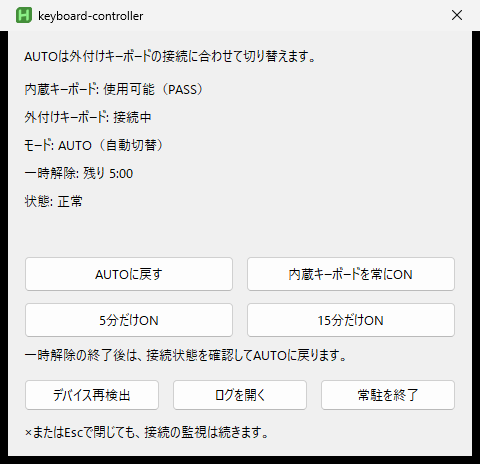

# keyboard-controller

ノートPCの上に外付けキーボードを置いて使うためのコントローラーです。指定した外付けキーボードが接続中と判断できる間だけ、選択した内蔵キーボードの入力を遮断します。切断・不明・エラー・終了時は解放します。

| OS | CPU | 実装・操作 | 初回に必要なこと |
| --- | --- | --- | --- |
| Windows 11 | x64 | AutoHotkey v2＋Interception、操作パネル | ドライバ導入の管理者承認と再起動 |
| Linux | x64 / arm64 | evdev、端末とアプリ一覧のランチャー | 選択したキーボードへのアクセス許可 |
| macOS 13以降 | Apple Silicon / Intel | IOHID、端末とApplications内のランチャー | 入力監視の許可と遮断時の管理者認証 |

Linux・macOSの利用者にGoやPythonのインストールは不要です。CIはWindows、Linuxの両CPU、macOSの両CPUで実行します。**macOSの物理キーボードを遮断・解放する実機試験は未実施**です。検証範囲は後述します。

## 導入

### Windows

1. [Releases](https://github.com/iiinno/keyboard-controller/releases)のWindows ZIPを展開し、`install.cmd` を開く
2. 初回セットアップでドライバ導入を選び、管理者承認・再起動を行う
3. スタートメニューの **Keyboard Controller → Setup** を開き、外付けの抜き差しに沿って①②③を押す
4. 8秒テストで入力と復旧を確認し、常駐を開始する

AutoHotkeyとInterceptionは公式配布物から自動取得し、固定のSHA-256で照合します。IDの手入力やDLLの手動配置は不要です。既存の `config.ini` とログは保持し、セットアップでIDを変更する場合は設定を `.bak` に退避します。

ソースから試す場合は、リポジトリ直下の `install.cmd` を使えます。詳細と従来の手動導入は [docs/setup.md](docs/setup.md) を参照してください。Windows ARM64はInterceptionドライバの対象外です。

### Linux・macOS

```sh
curl -fsSL https://raw.githubusercontent.com/iiinno/keyboard-controller/main/install.sh | sh
```

OS・CPUに合う配布物をSHA-256照合付きで取得し、内蔵・外付けを一覧から選びます。続いて `permissions --apply` でOSの許可を設定し、8秒テストを実行します。ランチャーから起動でき、端末で `on`、`auto`、`pause 5`、`pause 15`、`quit` を使えます。

macOSのランチャーは管理者認証を表示します。Linuxの自動権限設定はudev・logind環境向けで、対象の内蔵キーボードに限定します。詳細は [docs/cross-platform.md](docs/cross-platform.md) を参照してください。

**初回Releaseの公開前やPRのプレビュー**では、Actionsの `package-*` Artifactを使ってください。Linux・macOSは展開したArtifactに対して `sh install.sh --from DIR`、WindowsはArtifact内のZIPを展開して `install.cmd` で試せます。公開されていないReleaseを前提に成功扱いにはしません。

## 遮断する条件

次のすべてがそろう間だけ遮断します。

1. `AUTO` である
2. 設定した外付けの存在を確認できる
3. 一時解除・起動直後・復帰直後の待機中ではない
4. 内蔵を一意に識別でき、制御処理が正常である

マウスを含む複合デバイスや識別の曖昧さを推測で補いません。外付け・マウス・タッチパッドの入力をこのコントローラーで読み捨てることはしません。

`PASS` は、このコントローラーが遮断用のコンテキストを保持していない状態です。実際に物理キー入力がOSまで届いたことを測定した表示ではありません。

## Windowsの操作パネル

トレイアイコンを左右どちらかでクリックすると開きます。パネルを開いたままでも切断監視を続け、×またはEscで閉じるとパネルだけを非表示にします。



- **AUTOに戻す**: 現在の外付け接続状態で再判定
- **内蔵キーボードを常にON**: `FORCED_ON` に切替
- **5分だけON／15分だけON**: 一時解除。終了後は現在の接続状態を確認してAUTOへ戻る
- **デバイス再検出／ログを開く／常駐を終了**: 診断と終了

AUTOまたは常にONを選ぶと一時解除を取り消します。一時解除は再起動後には引き継ぎません。状態の再評価は `poll_ms` ごとです。

`toggle_hotkey` による切替も使えます。Logi Options+などでは「アプリケーション／ファイルを開く」で `tools/toggle.ahk` を指定できます。キーストロークの送信は不要です。

## Windowsの設定

`config.ini` はセットアップで作成します。手動設定する場合は `config.example.ini` をコピーしてください。端末ごとのIDを含むためGit管理しません。

| 設定 | 既定値 | 用途 |
| --- | ---: | --- |
| `poll_ms` | 1000 | 外付けの存在確認間隔 |
| `settle_ms` | 3000 | 起動・復帰後に待つ時間 |
| `drain_ms` | 10 | 遮断中の入力を読み捨てる間隔 |
| `resume_gap_factor` | 3 | 復帰の補助判定 |

`internal_keyboard.match` に一致するInterceptionキーボードが1台でなければ遮断しません。`exclude` は候補から除く追加条件です。手動設定の診断には `tools/list-devices.ahk` を使えます。

## 復旧

Windowsでは、外付けを切断し、マウスまたはタッチパッドからスタートメニューの **Recover** または `recover.ahk` を実行します。

Linux・macOSでは、常駐している端末をマウスから閉じるか、Ctrl+C／`quit` で終了します。起動時に表示したPIDへ終了シグナルを送る方法もあります。

改善しなければOSを再起動し、内蔵から実際に入力できることを確認してください。

## 検証

- Windows: 実行スクリプトの構文、設定、対象の一意性、マウス除外、解除失敗・再試行、ネイティブGUIの操作とタイマー継続を自動検証
- Windows導入: 標準PowerShell 5.1、依存の照合・配置、設定保持、使用中ファイルの更新拒否、初回ウィンドウ表示を検証
- Linux・macOS: 各CPU上でネイティブビルド、競合検査、状態遷移、実APIの読み取り専用列挙、パッケージからの導入、改変パッケージの拒否を検証
- Linux: 隔離した仮想キーボードで実際のEVIOCGRAB、内蔵側だけの入力抑止、外付けへの非干渉、解放後の復帰を検証

macOSの物理入力、個々の機種の複合デバイス構成、実際のスリープ復帰は上記CIだけでは保証できません。Windowsの従来の実機記録と検証手順は [docs/validation.md](docs/validation.md) にあります。

## 制約

- 存在検知は「実際に入力できる」ことの証明ではありません。本体の電源断後もUSBレシーバーが残る構成はAUTOの根拠にしないでください
- 遮断開始時に押していたキーのキーアップを捨てる可能性があります。切替時に内蔵のCtrl・Alt・Shiftなどを押しっぱなしにしないでください
- 他のキーボード制御ソフトがデバイスを独占している場合は取得に失敗します
- Linux・macOSのUIは端末です。Windowsの操作パネルと同じGUIを提供するものではありません

## 主なファイル

| パス | 用途 |
| --- | --- |
| `main.ahk` / `recover.ahk` | Windowsの常駐・復旧 |
| `tools/setup.ahk` | Windowsの抜き差し式セットアップ |
| `lib/` | Windowsの設定・識別・API・操作パネル |
| `portable/` | Linux・macOSの制御、CLI、ネイティブバックエンド |
| `install.cmd` / `install.ps1` / `install.sh` | OS別の導入 |
| `scripts/` | 配布パッケージの作成 |
| `tests/` / `.github/workflows/` | 自動検証・配布 |

## ライセンス・配布

このリポジトリのコードはMIT Licenseです。InterceptionやAutoHotkeyなど外部依存の条件は [THIRD_PARTY_NOTICES.md](THIRD_PARTY_NOTICES.md) と各公式配布物を確認してください。InterceptionのバイナリとドライバはソースにもWindows配布ZIPにも含めず、導入時に公式配布物から取得します。

メンテナーが `v0.1.0` のようなバージョンタグをpushすると、5種類のパッケージとチェックサムをビルド・検証後にReleaseへ公開します。PRのCIはArtifact作成までで、Releaseの公開やインストール済みアプリの更新は行いません。
